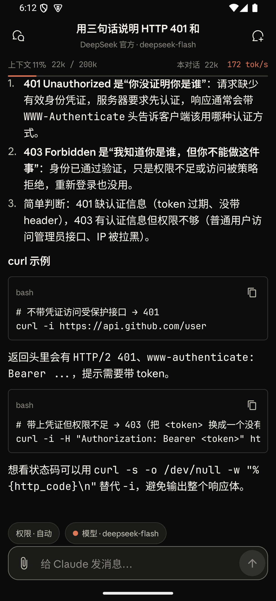
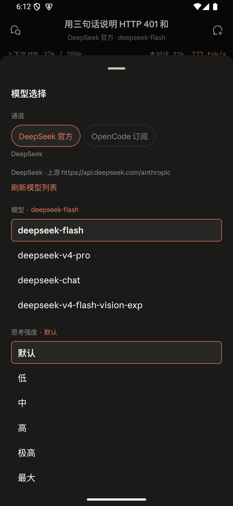
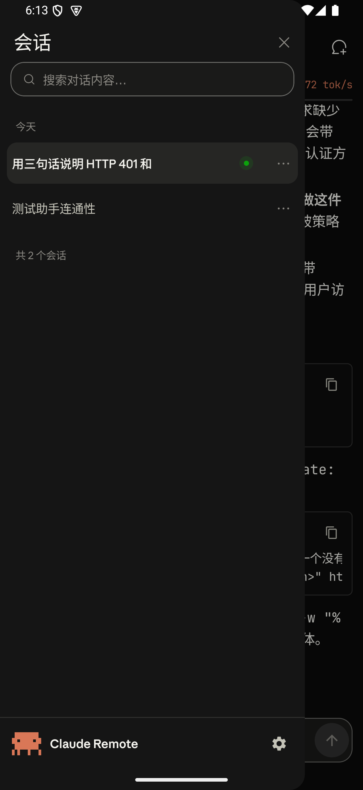

# Claude Remote

[中文](README.md) | [English](README.en.md)

Drive Claude Code on your computer from your phone. A small Node service runs on the desktop, an Android client talks to it over your network, and messages stream both ways — including permission prompts.

**Built for people running Claude Code against a third-party API.** DeepSeek, OpenCode, a relay, or your own reverse proxy all work. The project makes no assumptions about the upstream: if `claude -p "hi"` returns something on your machine, nothing else needs configuring here.



## The problem

Claude Code needs your project files, toolchain and credentials, so it runs on your computer. Walk away and the work stops.

Claude Remote puts that session on your phone. The phone is a terminal: typing, reading, approving. Execution, file access and model calls stay on the desktop. As long as the machine stays awake, the session keeps going.

## Quick start

Download `ClaudeRemote-*.zip` from [Releases](https://github.com/Jayce919/claude-remote/releases) and unzip it.

1. **Starting the service.** Double-click `启动服务.cmd` on Windows, or run `./start.sh` on macOS and Linux. The first run installs dependencies (about 30 seconds), then prints a phone URL and an access token.
2. **Installing the client.** Put the phone on the same Wi-Fi, open that URL in the browser, and install `Claude-Remote.apk` from the page.
3. **Connecting.** Open the app, enter the URL and the token, tap connect.

The bundle ships a `快速开始.html` walkthrough with screenshots.

Prerequisite: `claude -p "hi"` must work on the desktop. If it does not, fix that first — every later step depends on it.

## Features

| | |
|---|---|
| Streaming | Tokens arrive as they are generated, with time-to-first-token and tok/s |
| Markdown | Code blocks with copy buttons, tables, lists, KaTeX formulas |
| Permission prompts | Allow or deny tool use from the phone |
| Interactive cards | Single choice, multi choice, free-text notes, initiated by the model |
| Session management | Search, rename, pin, bulk delete, queued sends |
| Model and channel switching | With cc-switch installed, pick which upstream a session talks to |
| Attachments | Images go to vision models, text files are read inline |

<table>
<tr>
<td></td>
<td></td>
</tr>
</table>

## Deployment

### Local network

The service listens on `0.0.0.0` by default. Any device on the same Wi-Fi can connect; the address and token are printed at startup.

### Tailscale

Sign both machines into the same tailnet, then on the desktop:

```bash
tailscale serve --bg 8787
```

The phone then uses `https://<device>.<tailnet>.ts.net/`. Traffic is encrypted and works across networks.

On Windows, `server/connect.cmd` wraps both steps.

### Reverse proxy

The service speaks plain HTTP. Terminate TLS with Nginx or Caddy in front and point the app at the proxy.

## Running from source

```bash
cd server
npm install
npm start
```

Requires Node.js 22.5 or newer (`node:sqlite` landed in that release). The first start writes `server/config.json` with a random access token.

Build the Android client:

```bash
cd android
./gradlew assembleDebug          # Windows: gradlew.bat assembleDebug
```

Requires JDK 17 or newer. The Gradle wrapper is checked in.

Build a release bundle:

```bash
node tools/make-release.mjs
```

Output lands in `dist/` with `node_modules`, `data/` and `config.json` excluded.

## Configuration

`server/config.json` holds the common fields; `server/config.example.json` lists all of them.

| Field | Default | Purpose |
|---|---|---|
| `host` | `0.0.0.0` | Listen address. Use `127.0.0.1` for local-only |
| `port` | `8787` | Falls forward to the next free port when taken |
| `token` | random | Access token. Restart after changing |
| `claudePath` | `~/.local/bin/claude[.exe]` | Claude Code executable |
| `defaultCwd` | home directory | Working directory for new sessions |
| `allowedLogins` | `[]` | Tailnet logins allowed in without a token |

## Troubleshooting

Entries are keyed by the error you actually see.

**`Error: listen EADDRINUSE: address already in use 0.0.0.0:8787`**

The port is taken. The server tries the next ten ports before giving up; check the startup log for the port it settled on and use that in the app.

**`401` / `authentication_failed`**

The token in the app does not match `token` in `config.json`. Use the string printed at startup, and restart the service after editing the config.

**`402` / `Insufficient Balance` / `insufficient_quota`**

The upstream account is out of credit. Verify with `claude -p "hi"` on the desktop.

**`Not logged in · Please run /login`**

The spawned CLI has no upstream credentials. Check that `ANTHROPIC_BASE_URL` and `ANTHROPIC_AUTH_TOKEN` exist in `~/.claude/settings.json`, or in the service's process environment.

**`Cannot find package '@anthropic-ai/claude-agent-sdk'`**

Dependencies are missing. Run `npm install` inside `server/`, or relaunch through the launcher.

**`ERR_UNKNOWN_FILE_EXTENSION` / exits right after start**

Node is too old. `node -v` must be 22.5 or newer, otherwise `node:sqlite` is unavailable.

**`Model not found` / `The model does not exist`**

The selected model is not served upstream. Pick the default entry or type a model name your provider accepts. Without cc-switch, the list comes from the `models` array in `config.json`.

**Android: `CLEARTEXT communication to ... not permitted by network security policy`**

Plain HTTP is blocked by the system. The debug build distributed in releases allows cleartext; if you build from source, make sure you installed the debug variant.

**`spawn claude ENOENT`**

The executable cannot be found. Point `claudePath` at the real binary — on Windows usually `C:\Users\<you>\.local\bin\claude.exe`.

## Security

This service executes commands. Treat it as handing your shell to the phone.

- Every request requires the token, generated at random on first start
- It listens on all interfaces by default. Keep it on trusted networks and never map the port to the public internet
- Through `tailscale serve`, `allowedLogins` can replace the token with tailnet identity
- The token is a password. Do not paste it anywhere public

## Layout

```
server/          Node service: HTTP, SSE, auth, session management
android/         Kotlin + Jetpack Compose client
tools/           Launcher and packaging scripts
docs/            Release process and screenshots
```

## License

MIT
