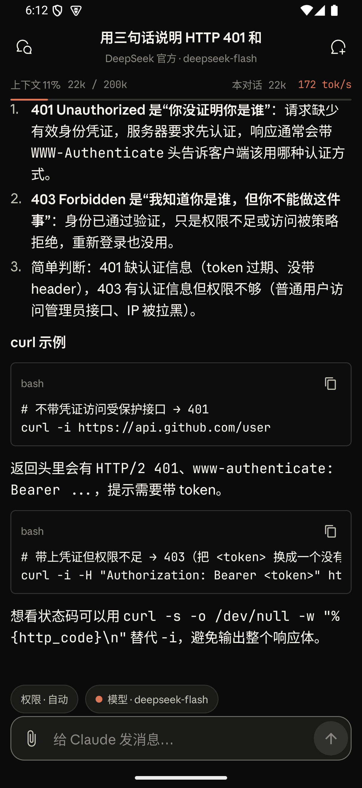
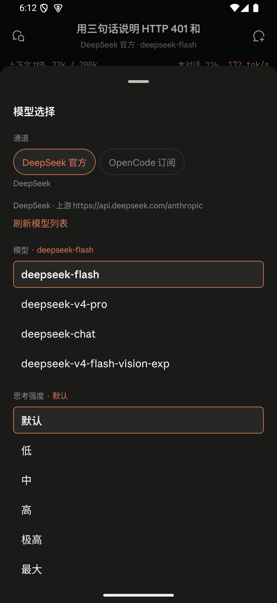
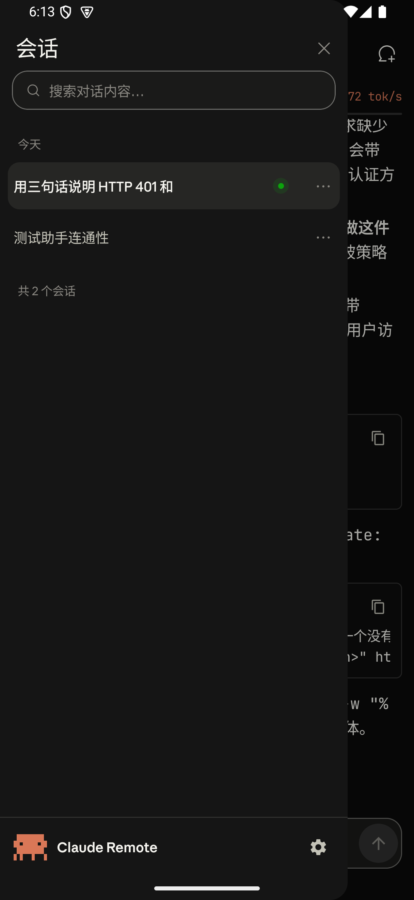

# Claude Remote

[中文](README.md) | [English](README.en.md)

用手机操作电脑上的 Claude Code。电脑跑一个 Node 服务，手机装一个安卓客户端，消息在两边实时同步，权限确认也在手机上点。

**这个项目面向用第三方 API 跑 Claude Code 的人。** DeepSeek、OpenCode、各类中转站，或者自己搭的反向代理，都在支持范围内。项目对上游不做任何假设：只要电脑上的 `claude -p "hi"` 能出结果，这里不用再配任何密钥。



## 它解决什么

Claude Code 需要照着项目文件、工具链和密钥运行，这些都在电脑上。人离开电脑，任务就停了。

Claude Remote 把电脑上的会话接到手机上。手机只负责显示和输入，命令执行、文件读写、模型调用仍然发生在电脑上。电脑不睡，任务就能继续。

## 快速开始

去 [Releases](https://github.com/Jayce919/claude-remote/releases) 下载 `ClaudeRemote-*.zip`，解压后：

1. **电脑上双击** `启动服务.cmd`（macOS / Linux 运行 `./start.sh`）。第一次会自动装依赖，约半分钟，之后窗口里会显示手机访问地址和访问令牌。
2. **手机连同一个 Wi-Fi**，浏览器打开那个地址，下载并安装页面上的 `Claude-Remote.apk`。
3. **打开 App**，填地址和令牌，点连接。

包里的 `快速开始.html` 有配图说明。

前置条件是电脑上 `claude -p "hi"` 能出结果。不通过就先修好它，后面的步骤都会失败。

## 功能

| | |
|---|---|
| 实时流式输出 | 回复逐字出现，带上首字延迟和 tok/s |
| 完整 Markdown | 代码块带复制按钮，表格、列表、公式都正常渲染 |
| 权限审批 | Claude Code 弹出工具权限时，手机上直接点允许或拒绝 |
| 交互卡片 | 单选、多选、备注输入，由模型发起 |
| 会话管理 | 搜索、重命名、置顶、多选删除、队列发送 |
| 模型与通道切换 | 装过 cc-switch 的话，可以在手机端切换直连哪条上游 |
| 附件 | 图片走视觉模型，普通文件按文本读取 |

<table>
<tr>
<td></td>
<td></td>
</tr>
</table>

## 部署方式

### 局域网（默认）

服务默认监听 `0.0.0.0`，手机和电脑在同一个 Wi-Fi 就能连。地址和令牌在启动窗口里。

### Tailscale

电脑和手机登录同一个 tailnet，然后在电脑上执行：

```bash
tailscale serve --bg 8787
```

之后手机访问 `https://<设备名>.<tailnet>.ts.net/`。走 HTTPS，跨网络也能用。

`server/connect.cmd` 把这两步包好了，Windows 上双击即可。

### 反向代理

服务本身只讲 HTTP，前面挂 Nginx 或 Caddy 终止 TLS 即可。App 里填代理后的地址。

## 从源码运行

```bash
cd server
npm install
npm start
```

需要 Node.js 22.5 以上（`node:sqlite` 从这一版开始可用）。首次启动会生成 `server/config.json` 并随机生成访问令牌。

构建安卓客户端：

```bash
cd android
./gradlew assembleDebug          # Windows: gradlew.bat assembleDebug
```

需要 JDK 17 以上。Gradle 由仓库自带的 wrapper 负责下载。

打发行包：

```bash
node tools/make-release.mjs
```

产物在 `dist/`，会自动排除 `node_modules`、`data/` 和 `config.json`。

## 配置

`server/config.json` 只列常用项，完整字段见 `server/config.example.json`。

| 字段 | 默认 | 说明 |
|---|---|---|
| `host` | `0.0.0.0` | 监听地址。只在本机用就改回 `127.0.0.1` |
| `port` | `8787` | 被占用时自动顺延 |
| `token` | 随机生成 | 访问令牌，改完要重启服务 |
| `claudePath` | `~/.local/bin/claude[.exe]` | Claude Code 可执行文件 |
| `defaultCwd` | 用户主目录 | 新会话的默认工作目录 |
| `allowedLogins` | `[]` | 经 Tailscale 访问时，这些 tailnet 登录名免令牌 |

## 常见问题

下面只列会报错的场景，按报错原文查。

**`Error: listen EADDRINUSE: address already in use 0.0.0.0:8787`**

端口被占用。服务会自动往后找 10 个端口，全被占才会退出。看启动日志里实际监听的端口，App 里填那个。

**`401` / `authentication_failed`**

App 里的令牌和服务端 `config.json` 的 `token` 不一致。以启动窗口打印的那串为准，改过配置要重启服务。

**`402` / `Insufficient Balance` / `insufficient_quota`**

上游账户余额或额度不够，与本项目无关。在电脑上跑一次 `claude -p "hi"` 确认。

**`Not logged in · Please run /login`**

派生的 CLI 没有拿到上游凭据。检查 `~/.claude/settings.json` 的 `env` 里是否有 `ANTHROPIC_BASE_URL` 和 `ANTHROPIC_AUTH_TOKEN`，或者服务的进程环境里是否带上了这两个变量。

**`Cannot find package '@anthropic-ai/claude-agent-sdk'`**

依赖没装。在 `server/` 下跑 `npm install`，或重新运行启动器。

**`ERR_UNKNOWN_FILE_EXTENSION` / 启动即退出**

Node 版本太旧。`node -v` 应大于等于 22.5，否则 `node:sqlite` 不可用。

**`Model not found` / `The model does not exist`**

App 里选的模型上游不支持。换成「默认」或者手填一个可用的模型名。没装 cc-switch 时，服务端只能从 `config.json` 的 `models` 数组取列表。

**安卓端 `CLEARTEXT communication to ... not permitted by network security policy`**

App 用明文 HTTP 连局域网被系统拦截。发行包里的 debug 版本已放开明文；自己从源码构建的话，需要确认安装的是 debug 包。

**`spawn claude ENOENT`**

找不到 Claude Code 可执行文件。把 `config.json` 的 `claudePath` 改成 `claude` 命令的实际路径。Windows 上通常是 `C:\Users\<用户名>\.local\bin\claude.exe`。

## 安全

这个服务能执行命令，等于把电脑的 shell 交给手机。

- 所有请求都要令牌，令牌在首次启动时随机生成
- 默认监听所有网卡。只在可信网络里使用，不要把端口映射到公网
- 经 `tailscale serve` 访问时，可以用 `allowedLogins` 换成 tailnet 身份免令牌
- 令牌等同于密码，不要贴到公开的地方

## 目录

```
server/           Node 服务端：HTTP、SSE、鉴权、会话管理
android/          Kotlin + Jetpack Compose 客户端
tools/            启动器与打包脚本
docs/             发版流程与截图
快速开始.html     打包内附的图文教程
```

## License

MIT
